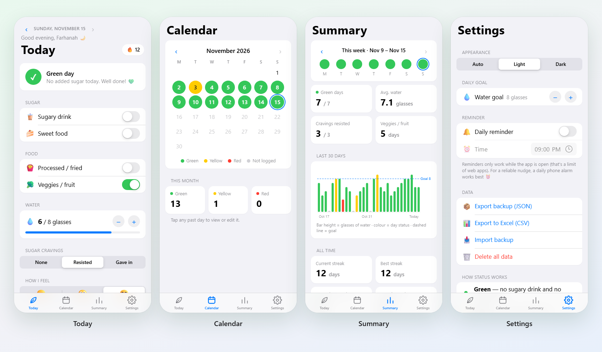

# 🌿 Farhanah's Green Days

*One green day at a time 🌿*

A small, personal daily tracker for eating clean and cutting sugar, made specially for Farhanah.
Tick a few things each day (it takes about 30 seconds) and watch the green days grow.



It's a Progressive Web App: a static site with no backend and no build step. It works offline and
can be added to the home screen on iPhone and Android, where it opens like a normal app.

## Features

- **Today**: one scrolling page.
  - **Dashboard**: the day's status, showing which foods caused any sugar, plus sugar toggles to
    correct it. A water card (+ Glass / + Bottle / Undo), highlights (veggie servings,
    fried/processed, protein) and one gentle tip.
  - **Meals** (when food tracking is on): Breakfast, Lunch, Dinner and Snacks below the dashboard.
  - **Evening check-in**: cravings, mood and notes, collapsible.
  - Every change saves automatically; "Save today" logs a perfect day where nothing needed ticking.
- **Gentle feedback**: a coloured status for each day, kind messages (never guilt-tripping), a
  🔥 streak and little celebrations at 3, 7, 14, 30, 60 and 100 green days.
- **Calendar**: month view with green / yellow / red days. Tap a day to see a summary, then
  "Open this day" to edit it.
- **Summary**: weekly overview, average water, cravings resisted, veggie days, a 30-day chart and
  all-time stats (current streak, best streak, total green days, days logged).
- **Settings**: Auto / Light / Dark theme, daily water goal, an optional reminder, JSON backup and
  restore, and export to Excel (CSV).
- Apple-style design, dark mode, safe-area aware, works offline.

### Food & calories (Settings → Diet)

On by default, and can be switched off in Settings → Diet. When on:

- **On the Today page**: a calorie ring at the top ("X kcal left", or "+X over goal" in neutral
  grey) with a protein bar. Below the dashboard are Breakfast / Lunch / Dinner / Snacks cards with
  subtotals, "+ Add food" and "Same as yesterday". Tap an entry to change its portion or meal;
  swipe left to delete, with Undo. Fried foods and veggies/fruit fill in the highlights
  automatically.
- **Home-screen shortcut**: long-press the app icon (Android) for **Add food**, or open
  `./?action=add-food`.
- **Add food sheet**: Favourites, Recent (last 10 foods), barcode scan and Quick add, plus search
  over 1,200 Malaysian foods and drinks (`foods.js`: hawker, mamak, nasi campur lauk, kuih, fruit, sushi, Korean, Thai, Mixue, ZUS, Tealive, packaged brands,
  drinks, fast-food chains, convenience-store items) and your own foods. The **+** button adds one
  standard serving in a single tap. The portion picker (½, ¾, 1, 1½, 2) has a hand-size guide.
- **Build a plate**: estimate home-cooked food or nasi campur without typing numbers. Pick the
  carbs (fists), protein (palms, with grilled/curry/fried), veggies and oil/sambal (thumbs).
- **Barcode scanning**: uses the camera (native `BarcodeDetector`, or ZXing loaded from a CDN only
  when needed) with "Type barcode instead" as a fallback. Products are looked up on
  [Open Food Facts](https://world.openfoodfacts.org). If a product has no calories there, the app
  fills in a typical value for its category (clearly marked as an estimate) or lets her
  "Use a similar food". Whatever she confirms is saved, so the next scan is instant and works offline.
- **Linked with the sugar tracker**: adding a sugary drink or sweet food switches on the matching
  toggle for that day.
- **Calorie goal calculator**: Mifflin-St Jeor × activity level, with Maintain / Gentle loss (−300) /
  Steady loss (−500). It never suggests less than 1,200 kcal. Optional protein goal (≈ 1.2 g/kg).
- **Weekly weigh-in**: weight log with a trend line, plus a gentle banner on your chosen day.
- **Summary**: average calories and protein, days on target (±10%), and a Water / Calories chart toggle.
- Exports: meals CSV and weight CSV. The JSON backup includes everything.

> Calorie values in `foods.js` are estimates per standard serving, based on Malaysian food
> composition data (MyFCD) and published hawker-food calorie lists. Portions vary, so consistency
> matters more than perfection. To correct a value, edit `foods.js` and bump the cache version.

## How status works

| Status | Meaning |
| --- | --- |
| 🟢 Green | No sugary drink **and** no sweet food |
| 🟡 Yellow | Only one of the two |
| 🔴 Red | Both |

- **Current streak**: green days in a row, ending today. If today isn't logged yet, it counts up to
  yesterday, so the streak isn't lost before bedtime.
- **Best streak**: the longest run of green days ever.

## Deploy on GitHub Pages (free)

1. Create a new **public** repository on GitHub called `farhanahs-green-days`.
2. Upload every file in this folder (`index.html`, `style.css`, `app.js`, `sw.js`, `manifest.json`,
   the `icons/` folder, `README.md`, `preview.png`), either with **Add file → Upload files** or with
   `git push`.
3. In the repository, open **Settings → Pages**.
4. Under **Build and deployment**, choose **Source: Deploy from a branch**, then **Branch: `main`**
   and folder **`/ (root)`**, and click **Save**.
5. After a minute or two the app is live at
   `https://<your-username>.github.io/farhanahs-green-days/`.

All paths are relative, so the app works from that sub-folder without changes.

## Install on your phone

**iPhone (Safari)**
1. Open the link in **Safari**.
2. Tap the **Share** button (the square with an arrow).
3. Tap **Add to Home Screen**, then **Add**.

**Android (Chrome)**
1. Open the link in **Chrome**.
2. Tap the **⋮** menu.
3. Tap **Install app** (or **Add to Home screen**).

The "Green Days" icon then opens the app full-screen, and it works offline.

## Updating the app

The service worker caches the files so the app works offline. **After changing any file, bump the
cache version** at the top of `sw.js`:

```js
var CACHE = 'fgd-v1'; // → 'fgd-v2', 'fgd-v3', …
```

The new version loads in the background; close and reopen the app to see it. To change the accent
colour, edit `--accent` at the top of `style.css`.

## Privacy

All data is stored **only on your device** (in the browser's `localStorage`). Nothing is sent
anywhere and there are no accounts, trackers or analytics. The one exception is when you look up a
barcode: only the barcode number is sent to Open Food Facts to fetch the product details.

Because the data lives in the browser, clearing Safari/Chrome website data, or deleting the app,
also deletes your log. **Export a backup regularly** (Settings → Export backup) and keep the file
somewhere safe. You can restore it with **Import backup**, which merges entries by date.

> Reminders only work while the app is open (a limit of web apps). A daily phone alarm is more
> reliable.

## File structure

```
farhanahs-green-days/
├── index.html      # app shell and all four tabs
├── guide.html      # simple user guide (iPhone), linked from Settings
├── style.css       # iOS-style design, light & dark themes (--accent at the top)
├── app.js          # logic: logging, status, streaks, calendar, summary, settings, diet, export/import
├── foods.js        # built-in Malaysian food list (kcal & protein per serving), easy to edit
├── sw.js           # service worker (offline cache, bump version after changes)
├── manifest.json   # PWA manifest (name, icons, colours)
├── icons/
│   ├── icon-180.png  # Apple touch icon
│   ├── icon-192.png
│   └── icon-512.png  # also used as the maskable icon
├── preview.png     # screenshot for this README
└── README.md
```

---

Made with 💚 for Farhanah
